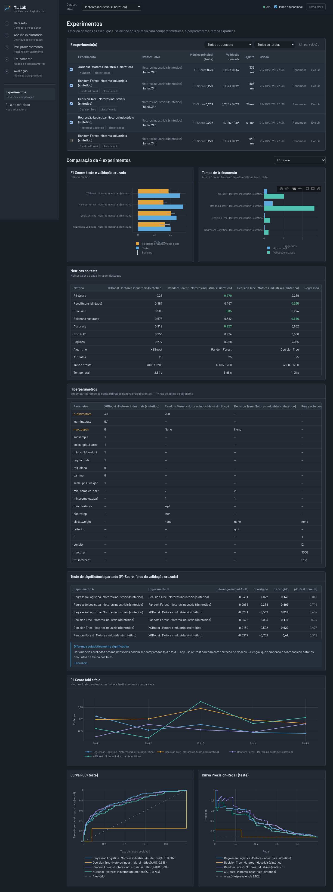

# ML Lab

[](https://github.com/Victor-alrib/ml-lab/actions/workflows/ci.yml)

**Laboratório web para treinar, avaliar e comparar modelos de Machine Learning em dados industriais, com validação feita para não vazar informação do conjunto de teste.**



---

## Problema

Treinar um modelo com scikit-learn leva poucas linhas. Provar que ele é bom é a parte difícil, e é nela que os erros acontecem:

- **Classes raras.** Falhas de equipamento costumam ser poucos por cento dos registros. Um modelo que nunca prevê falha já tem accuracy alta, e não serve para nada.
- **Vazamento de dados.** Calcular médias de normalização no dataset inteiro antes de separar o teste, embaralhar leituras de sensor vizinhas no tempo ou usar uma coluna registrada *depois* da falha: tudo isso infla as métricas no papel e derruba o modelo em produção.
- **Comparações sem rigor.** "O XGBoost teve F1 0,26 e a árvore 0,24" não diz se a diferença é real ou ruído da amostragem.

O ML Lab é uma ferramenta para estudar e praticar esse rigor com dados reais, com cada etapa visível na tela.

## Abordagem

### Fluxo

`Dataset → Análise exploratória → Pré-processamento → Treinamento → Avaliação → Comparação`

| Módulo | O que faz |
|---|---|
| Datasets | Upload de CSV (detecta `;` e decimal com vírgula), tipos de variáveis, estatísticas descritivas, valores ausentes, outliers (IQR e z-score) |
| Análise exploratória | Histogramas, boxplots, correlação (Pearson/Spearman/Kendall), dispersão, testes de normalidade e Q-Q plot, com filtros interativos |
| Pré-processamento | Imputação, escala, codificação, seleção de atributos, separação aleatória/estratificada/temporal. Mostra o que foi aprendido no treino |
| Treinamento | Regressão Linear, Regressão Logística, Decision Tree, Random Forest e XGBoost, com hiperparâmetros configuráveis |
| Avaliação | Accuracy, precision, recall, F1, ROC AUC, matriz de confusão, curvas ROC/PR, limiar de decisão; MAE, RMSE, R², resíduos; validação cruzada e baseline |
| Experimentos | Histórico salvo e comparação lado a lado, com teste de significância estatística |
| Modo educacional | Explicação de cada métrica e conceito, com exemplos industriais |

### Decisões técnicas e por quê

| Escolha | Motivo |
|---|---|
| Todo o pré-processamento dentro de um `sklearn.Pipeline` com o modelo no fim | O pipeline é ajustado só no treino e **reajustado em cada fold** da validação cruzada. Assim, média, desvio, categorias e seleção de atributos nunca veem dados de validação ou de teste |
| Baseline ingênuo (`DummyClassifier`/`DummyRegressor`) avaliado nas mesmas condições | Dá a referência mínima: se o modelo não supera "sempre prever sem falha", ele não aprendeu nada útil |
| F1 como métrica principal de classificação; RMSE na regressão | Accuracy engana com classes desbalanceadas; RMSE fica na unidade física e pune erros grandes |
| Separação temporal + `TimeSeriesSplit` como opção | Leituras de sensor vizinhas são quase iguais. Embaralhar deixa o modelo "ver o futuro" |
| Detector de vazamento por atributo | Cada coluna é testada sozinha (árvore rasa, CV de 3 folds, só no treino). Se uma única coluna prevê o alvo quase perfeitamente, o app alerta e oferece removê-la |
| Limiar escolhido com probabilidades *out-of-fold* | O limiar de decisão é ajustado na validação cruzada, nunca olhando o teste |
| t-test pareado com correção de Nadeau & Bengio | Os folds compartilham dados de treino; o t-test comum subestima a variância e acusa diferenças que não existem |

### Dados

- **Upload de qualquer CSV.**
- **Dataset sintético de motores industriais:** 6.000 leituras simuladas de 10 motores (temperatura, corrente, vibração, carga, horas desde a manutenção…), com ausentes, picos de sensor e uma coluna que vaza o alvo de propósito. É gerado por código, com semente fixa, e **não representa equipamento real**.
- **Datasets reais do scikit-learn:** Breast Cancer Wisconsin (569 linhas), Diabetes (442) e Wine (178).

## Resultados

### Engenharia
- **22 testes automatizados passando** ([saída](resultados/testes_backend.txt)). Eles conferem as métricas exibidas contra recálculos independentes com scikit-learn e provam a ausência de vazamento. Exemplos: a média do `StandardScaler` é a do treino, não a do dataset completo; em cada fold, o scaler é ajustado só com os dados daquele fold.
- **Teste de ponta a ponta no navegador:** o fluxo completo (dados → EDA → pré-processamento → treino → avaliação → comparação) rodou num Chromium automatizado sem erros no console ([capturas](resultados/capturas)).
- Tamanho: cerca de 2.500 linhas de Python no backend, 280 de testes e 5.000 de TypeScript/CSS no frontend.

### Experimentos no dataset sintético
Detalhes completos e reprodução em [`resultados/`](resultados/README.md).

**Classificação de falha nas próximas 24 h** (8,5% de positivos, 1.200 linhas de teste):

| Modelo | F1 teste | F1 na validação cruzada | Recall | ROC AUC | Accuracy (baseline 0,915) |
|---|---|---|---|---|---|
| Regressão Logística | 0,202 | 0,166 ± 0,030 | 0,118 | 0,802 | 0,921 |
| Decision Tree | 0,239 | 0,205 ± 0,024 | 0,255 | 0,586 | 0,862 |
| Random Forest | 0,279 | 0,157 ± 0,023 | 0,167 | 0,794 | 0,927 |
| XGBoost | 0,260 | 0,189 ± 0,057 | 0,167 | 0,753 | 0,919 |

- O detector apontou `modo_falha` (balanced accuracy = 1,000 sozinha), que foi removida antes do treino.
- Com os hiperparâmetros padrão há overfitting forte: Decision Tree e Random Forest chegam a F1 = 1,000 no treino.
- Nenhuma diferença de F1 entre os modelos é estatisticamente significativa. O t-test comum daria p = 0,048 para Regressão Logística × Decision Tree; com a correção, p = 0,135.

**Regressão da temperatura do rolamento** (separação temporal): o XGBoost teve RMSE de 2,93 °C contra 13,02 °C do baseline (R² 0,929). O R² alto é esperado, porque o alvo sintético é uma fórmula das entradas.

## Como rodar

**Requisitos:** Python 3.10+ e Node.js 20+. Nenhuma chave de API, senha ou token é necessária.

**1. API** (terminal 1)

```bash
cd backend
python -m venv .venv
# Windows (PowerShell):  .venv\Scripts\Activate.ps1
# Linux/macOS:           source .venv/bin/activate
pip install -r requirements-dev.txt
uvicorn app.main:app --reload --port 8000
```

**2. Interface** (terminal 2)

```bash
cd frontend
npm install
npm run dev
```

Abra **http://localhost:5173** e clique em "Carregar" num dataset de exemplo. A documentação da API fica em http://localhost:8000/docs.

**Testes**

```bash
cd backend && pytest
cd frontend && npm run build
```

**Reproduzir os resultados**

```bash
cd backend && python -m scripts.reproduzir_resultados ../resultados
```

**Docker** (alternativa): `docker compose up --build` na raiz do repositório, depois abra http://localhost:8000.

### Configuração por variáveis de ambiente

O projeto não usa nenhum segredo. As configurações opcionais são lidas de variáveis de ambiente, nunca escritas no código:

| Variável | Padrão | Uso |
|---|---|---|
| `MLLAB_DATA_DIR` | `backend/storage` | Onde datasets, experimentos e modelos são gravados |
| `MLLAB_MAX_UPLOAD_MB` | `100` | Tamanho máximo do CSV |
| `MLLAB_CORS_ORIGINS` | `http://localhost:5173,…` | Origens permitidas para a API |
| `VITE_API_URL` | vazio | URL da API, se o frontend estiver em outro endereço |

## Limitações

- Validado com dados sintéticos e com os datasets de exemplo do scikit-learn; ainda não foi aplicado a dados de uma planta real.
- Não há busca automática de hiperparâmetros (grid/random/bayesiana).
- A separação temporal existe, mas ainda não há atributos de série temporal (médias móveis, defasagens).
- Por padrão, identificadores com poucos valores (como `motor_id`, 10 motores) entram como atributos; no experimento, eles aparecem entre os mais importantes do XGBoost, o que não generaliza para equipamentos novos.
- O detector de vazamento é uma heurística com limiares fixos (balanced accuracy ≥ 0,985 ou R² ≥ 0,98). Ele não pega vazamentos sutis.
- Na separação temporal, a correção de Nadeau-Bengio é aproximada (os folds do `TimeSeriesSplit` têm tamanhos diferentes).
- Uso local e de um usuário só: sem login, persistência em arquivos JSON.

## Próximos passos

- [ ] Rodar no **AI4I 2020** (UCI) ou no **C-MAPSS** (NASA) e documentar os resultados reais
- [ ] Atributos de janela temporal e modelos de previsão (ARIMA/Prophet)
- [ ] Busca de hiperparâmetros com validação cruzada aninhada
- [ ] Detecção de anomalia (Isolation Forest; autoencoder em PyTorch)
- [ ] Rastreamento de experimentos com MLflow e endpoint de predição

## Tecnologias

**Backend:** Python, FastAPI, scikit-learn, XGBoost, pandas, NumPy, SciPy, joblib, pytest, ruff
**Frontend:** React 19, TypeScript, Tailwind CSS 4, Plotly.js, Vite
**Infra:** Docker, GitHub Actions (CI)

## Estrutura

```
ml-lab/
├── backend/        API FastAPI, serviços de ML, testes, scripts
├── frontend/       interface React
├── docs/           arquitetura e endpoints
├── sample_data/    CSVs dos datasets de exemplo
├── resultados/     métricas, testes e capturas de tela
├── Dockerfile
└── docker-compose.yml
```

## Autoria

Desenvolvido por **Victor** (Engenharia de Controle e Automação — IFSP), com auxílio de IA (Claude) na escrita do código e da documentação.

## Licença

[MIT](LICENSE)
